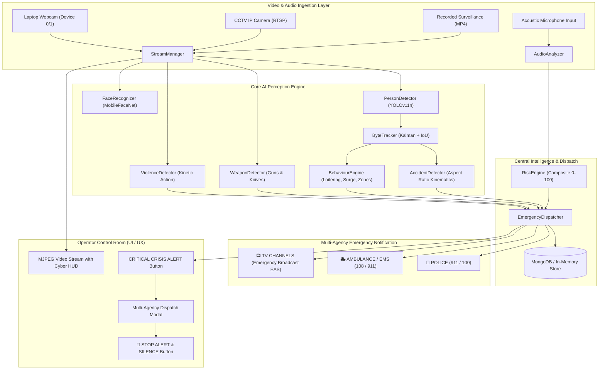
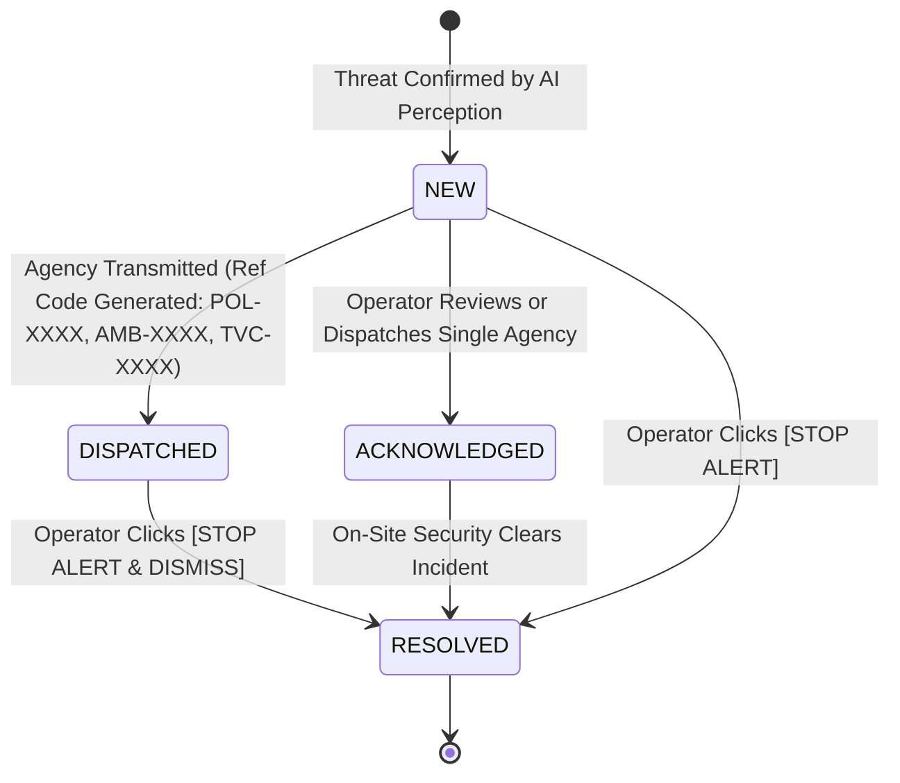

# CROWDGUARD AI: Enterprise Intelligent Surveillance & Emergency Crisis Dispatch System
## Complete System Architecture, AI Pipeline & Operational Reference Manual

---

## 1. Executive Summary & Mission Overview

**CrowdGuard AI** is an enterprise-grade autonomous surveillance, threat detection, and multi-agency emergency dispatch platform. Designed for high-density public hubs, mass transit stations, corporate campuses, and restricted facilities, CrowdGuard AI combines state-of-the-art computer vision (YOLOv11), persistent multi-object tracking (ByteTrack), temporal action kinematics, acoustic scream analysis, and automated multi-agency dispatch to deliver end-to-end situational awareness with zero human latency.

### Core Operating Principles
1. **Zero Hallucination / Clean Slate Standby**: Video feeds remain pitch-black in standby until active camera feeds are turned on. No fake synthetic pedestrians, mock silhouettes, or fabricated bounding boxes are rendered.
2. **Exact Real-Time Person Identification**: Live YOLO inference outputs the real-time count of visible human subjects with exact motion classification (stationary, walking, running) and kinematics.
3. **Multi-Hazard Threat Detection**:
   - **Weapons & Firearms**: Guns, handguns, rifles, and knives detected with multi-frame temporal persistence.
   - **Accidents & Medical Collapses**: Aspect-ratio kinematics ($w/h \ge 1.15$) and rapid vertical centroid drops detect fallen pedestrians, collapses, and vehicle collisions.
   - **Lethal Violence & Altercations**: Kinetic 3D window analysis flags physical assaults and violent engagements.
   - **Crowd Disaster & Stampede Risk**: Velocity vectors, sudden directional surges, and mass panic running identify stampede hazards before casualties occur.
4. **Automated Multi-Agency Dispatch**: Direct, automated emergency dispatch workflows coordinate:
   - 🚨 **Police Department (911 / 100)**: Armed intruder interception, SWAT dispatch, tactical coordinates.
   - 🚑 **Ambulance / EMS (108 / 911)**: Casualty triage, paramedic trauma units, hospital priority routing.
   - 📺 **TV Channels & Media (EAS)**: Emergency news crawl, public evacuation advisory, sector bulletins.
5. **Operator Control & Smart Alert Suppression**: High-urgency alert notifications are non-intrusive. The system does not lock or obscure the screen with automatic pop-ups until the operator presses **`CRITICAL SURVEILLANCE CRISIS ALERT`**. A dedicated **`[STOP ALERT]`** button halts audio alarms and clears threat states instantly.

---

## 2. High-Level System Architecture



---

## 3. Perception Modules & AI Subsystems

### 3.1. Person Detection & Motion Tracking
- **File**: [`detection/person_detector.py`](file:///c:/Users/Rohith/Desktop/project3/detection/person_detector.py)
- **Engine**: Ultralytics YOLOv11 nano (`yolo11n.pt`) optimized for CPU/GPU inference.
- **Filtering**: Strictly filters COCO Class 0 (`person`) at user-configurable confidence thresholds (default: 0.45).
- **Exact Identification**: Replaces arbitrary default person IDs with real-time person enumeration: `PERSON X OF Y [conf%]`.
- **Motion Kinematics**:
  - Velocity calculated per frame: $v = \sqrt{\Delta x^2 + \Delta y^2}$.
  - Stationary: $v \le 1.5\text{ px/f}$ (Cyan telemetry).
  - Walking: $1.5 < v \le 15.0\text{ px/f}$ (Neon green telemetry with 8-compass direction).
  - Running: $v > 15.0\text{ px/f}$ (High-visibility amber telemetry).

### 3.2. Pitch-Black Standby & Inactive Screen Engine
- **File**: [`detection/utils.py`](file:///c:/Users/Rohith/Desktop/project3/detection/utils.py)
- **Function**: `create_camera_standby_frame()`
- **Behavior**: When a camera worker is in standby, warming up, or not yet activated by the operator, the feed displays a pure black surveillance screen (`np.zeros`) with a clean security standby watermark (`CAMERA STANDBY // INACTIVE`).
- **Zero Simulation**: Fabricated silhouettes and hardcoded pedestrian coordinates have been removed. Standby feeds return strictly 0 detections.

### 3.3. Dedicated Weapon & Firearm Detector
- **File**: [`detection/weapon_detector.py`](file:///c:/Users/Rohith/Desktop/project3/detection/weapon_detector.py)
- **Supported Classes**: `gun`, `pistol`, `rifle`, `firearm`, `knife`, `blade`, `weapon`.
- **Temporal Persistence**: Requires weapon presence across $N$ consecutive frames (default: 4) before triggering an alert, eliminating momentary false-positive glitches.
- **Alert Dispatch**: Auto-logs `WEAPON_DETECTED` with severity `CRITICAL`, routes to Police, Ambulance, and TV News channels, and renders a red corner-bracket warning overlay.

### 3.4. AI Accident & Medical Collapse Detector
- **File**: [`detection/accident_detector.py`](file:///c:/Users/Rohith/Desktop/project3/detection/accident_detector.py)
- **Detection Algorithm**:
  - Standing human bounding box aspect ratio: $AR = \frac{width}{height} \approx 0.3 - 0.5$.
  - Fallen / collapsed human bounding box aspect ratio: $AR \ge 1.15$ sustained horizontally over $\ge 3$ consecutive frames with minimal vertical drift.
- **Alert Dispatch**: Auto-logs `ACCIDENT_DETECTED` with severity `HIGH`, targets Ambulance/EMS and Police, and renders safety-orange HUD overlays: `EMERGENCY: ACCIDENT (FALL/COLLAPSE) [conf%]`.

### 3.5. Temporal Violence & Assault Recognition
- **File**: [`violence/action_model.py`](file:///c:/Users/Rohith/Desktop/project3/violence/action_model.py)
- **Temporal Analysis**: Buffers a rolling window of video frames (default: 16-30 frames) to analyze kinetic energy differentials across multiple interacting bounding boxes.
- **Alert Dispatch**: Flags violent physical altercations (`POSSIBLE_VIOLENCE`), notifies Police and Ambulance, and logs historical behavioral incidents.

### 3.6. Behaviour Engine & Crowd Stampede Risk
- **File**: [`behaviour/abnormal.py`](file:///c:/Users/Rohith/Desktop/project3/behaviour/abnormal.py)
- **Sub-Modules**:
  - **Loitering Detection** ([`behaviour/loitering.py`](file:///c:/Users/Rohith/Desktop/project3/behaviour/loitering.py)): Tracks dwell time within bounding sectors; alerts if stationary time exceeds threshold (e.g. > 120s).
  - **Restricted Zone Intrusion** ([`behaviour/zones.py`](file:///c:/Users/Rohith/Desktop/project3/behaviour/zones.py)): Polygon point-in-polygon ray-casting detects unauthorized boundary crossings.
  - **Crowd Disaster & Stampede**: Detects sudden mass velocity surges toward common vectors, triggering `CROWD_DISASTER_RISK` broadcasts to Police, Ambulance, and TV Channels.

### 3.7. Multi-Object Tracking (ByteTrack)
- **File**: [`tracking/tracker.py`](file:///c:/Users/Rohith/Desktop/project3/tracking/tracker.py)
- **Methodology**: Two-stage bipartite matching using Kalman filter state estimation and Intersection-over-Union (IoU) cost matrix.
- **Persistence**: Retains lost tracks for up to 30 frames to handle occlusions and passing behind architectural pillars.

### 3.8. Acoustic Anomaly & Scream Detector
- **File**: [`audio/audio_analyzer.py`](file:///c:/Users/Rohith/Desktop/project3/audio/audio_analyzer.py)
- **Acoustic Analysis**: Computes Short-Time Fourier Transform (STFT), Mel-frequency cepstral coefficients (MFCCs), spectral centroid, and decibel amplitude.
- **Thresholds**: Flags high-pitched human screaming ($> 85\text{ dB}$, pitch $> 1200\text{ Hz}$) and gunshots/explosions.

### 3.9. Face Recognition & Watchlist Identification
- **File**: [`detection/face_recognizer.py`](file:///c:/Users/Rohith/Desktop/project3/detection/face_recognizer.py)
- **Database**: [`models/face/known_faces.json`](file:///c:/Users/Rohith/Desktop/project3/models/face/known_faces.json)
- **Capability**: Detects facial regions, calculates normalized 128D/512D facial embeddings, and compares cosine distance against authorized personnel and person-of-interest watchlists. Starts clean with 0 default seed identities.

### 3.10. Multimodal LLM Vision Security Scanner
- **File**: [`detection/llm_vision.py`](file:///c:/Users/Rohith/Desktop/project3/detection/llm_vision.py)
- **Integration**: Google Gemini Vision API (`gemini-1.5-flash` / `gemini-1.5-pro`).
- **Capability**: On-demand deep scene analysis. Operators click **`[Scan with LLM Vision]`** to receive detailed semantic assessments of suspicious unattended bags, concealed items, and human behavioral intent.

---

## 4. Multi-Agency Emergency Dispatch Coordinator

### 4.1. Coordinator Architecture
- **File**: [`alerts/emergency_dispatcher.py`](file:///c:/Users/Rohith/Desktop/project3/alerts/emergency_dispatcher.py)
- **Singleton**: `EmergencyDispatcher` orchestrates all urgent agency communications.

### 4.2. Agency Dispatch Matrix

| Threat Category | Primary Target Agencies | Emergency Dial | Operational Objective |
| :--- | :--- | :--- | :--- |
| **Guns, Weapons, Armed Threat** | `POLICE`, `TV_CHANNEL`, `AMBULANCE` | 911 / 100 | Tactical armed interception, evacuation broadcast, trauma readiness |
| **Accidents, Falls, Collapses** | `AMBULANCE`, `POLICE` | 108 / 911 | Emergency medical first-responders, casualty triage, perimeter safety |
| **Violence, Lethal Altercation** | `POLICE`, `AMBULANCE`, `TV_CHANNEL` | 911 / 100 | Rapid officer intervention, paramedic staging, public warning |
| **Crowd Stampede / Disaster** | `POLICE`, `AMBULANCE`, `TV_CHANNEL` | 911 / 108 | Crowd control, mass-casualty triage, public evacuation crawl |

### 4.3. Dispatch Verification Lifecycle


---

## 5. User Interface & Operator Controls

### 5.1. Non-Intrusive Crisis Notification Workflow
- **Problem Solved**: Unprompted popup modals previously blocked video streams during critical surveillance operations.
- **Implementation**:
  - When a threat occurs or is simulated, the modal **does NOT pop up automatically**.
  - A pulsing red notification button appears in the top navigation bar:
    **`[🚨 CRITICAL SURVEILLANCE CRISIS ALERT | THREAT_TYPE]`**
  - A matching pill lights up directly above the CCTV camera viewport.
  - The modal dialog appears **only when the operator explicitly clicks on this button**.

### 5.2. Emergency Stop & Audio Siren Controls
- **Global Topbar Stop Button**: `[🛑 STOP ALERT]` appears in the header on every page when an alert is active. One click halts all sirens and resolves the emergency.
- **Modal Stop & Dismiss**: Inside the modal, `[🛑 STOP ALARM & DISMISS]` immediately silences Web Audio oscillator frequencies (880Hz / 660Hz) and resolves backend state.
- **Smart Suppression**: Dismissed alerts are cached in `sessionStorage` (`CG_SILENCED_ALERTS`) so that refreshing or navigating pages does not re-trigger alerts.

### 5.3. Simulation Drill Simulator
Located on the Live Cameras, Threats, and Dashboard pages:
- `[🚨 Test Gun Threat]`: Simulates armed subject with handgun; tests Police, EMS, and TV dispatch.
- `[🚑 Test Accident/Fall]`: Simulates pedestrian collapse; tests Ambulance priority routing.
- `[💥 Test Violence]`: Simulates physical fight; tests tactical intervention workflows.
- `[🏃 Test Crowd Risk]`: Simulates mass stampede panic; tests public evacuation warning.
- `[🛑 Stop Alert]`: Instantly halts any active drill.

---

## 6. REST API Reference

### 6.1. Emergency & Alert Endpoints

| Method | Endpoint | Request Body | Response | Description |
| :--- | :--- | :--- | :--- | :--- |
| `GET` | `/api/alerts` | `?camera_id=...&severity=...` | `{ status, count, data: [...] }` | Query logged surveillance alerts |
| `POST` | `/api/alerts` | `{ camera_id, event_type, severity, ... }` | `{ status, data: { alert_doc } }` | Manually log a threat alert |
| `GET` | `/api/alerts/active_emergency` | *None* | `{ status, has_active_emergency, emergency }` | Poll current unresolved crisis event |
| `POST` | `/api/alerts/dispatch` | `{ event_id, agency, notes }` | `{ status, message, result }` | Dispatch `POLICE`, `AMBULANCE`, `TV_CHANNEL`, or `ALL` |
| `POST` | `/api/alerts/stop_emergency` | `{ event_id }` | `{ status, message, data }` | Stop alert, silence audio, clear camera overlays |
| `POST` | `/api/alerts/simulate_threat` | `{ threat_type, camera_id }` | `{ status, data: { emergency_event } }` | Trigger test simulation drill |
| `POST` | `/api/alerts/<id>/ack` | `{ officer_name }` | `{ status, data }` | Acknowledge threat alert |
| `POST` | `/api/alerts/<id>/resolve` | *None* | `{ status, data }` | Mark threat resolved |
| `POST` | `/api/alerts/<id>/false_positive` | *None* | `{ status, data }` | Mark false alarm |

### 6.2. Camera & Stream Endpoints

| Method | Endpoint | Request Body | Response | Description |
| :--- | :--- | :--- | :--- | :--- |
| `GET` | `/api/cameras` | *None* | `{ status, count, data: [...] }` | List registered CCTV cameras |
| `POST` | `/api/cameras` | `{ camera_id, name, stream_url, ... }` | `{ status, data }` | Register new camera stream |
| `GET` | `/api/cameras/<id>/stream` | *None* | `multipart/x-mixed-replace; boundary=frame` | Live MJPEG video stream with HUD |
| `GET` | `/api/cameras/<id>/detections` | *None* | `{ status, detections: [...] }` | Get real-time tracked persons & velocities |
| `POST` | `/api/cameras/<id>/activate_webcam`| `{ device_index: 0 }` | `{ success, stream_url }` | Connect laptop webcam to camera node |
| `POST` | `/api/cameras/<id>/frame` | Multipart form (image file) | `{ success, detections, faces, weapons }` | Ingest browser WebRTC canvas frame |
| `POST` | `/api/cameras/<id>/llm_scan` | *None* | `{ status, analysis }` | Run Gemini Vision multimodal scan |
| `POST` | `/api/database/clear` | *None* | `{ status, message }` | Wipe database to clean slate |

---

## 7. Database Architecture & Persistence

- **File**: [`database/mongo.py`](file:///c:/Users/Rohith/Desktop/project3/database/mongo.py)
- **Primary Store**: MongoDB (`surveillance_db` on `localhost:27017`).
- **Resilient Fallback**: If MongoDB is offline, automatically operates in in-memory mode without crashing.
- **Clean Slate Policy**: Default seed data arrays (`INITIAL_CAMERAS`, `INITIAL_ALERTS`) are strictly empty (`[]`).
- **Collections & Indexes**:
  - `cameras`: Indexed on `camera_id` (unique), `status`.
  - `alerts`: Indexed on `event_id` (unique), `timestamp` (descending), `severity`, `status`.
  - `behaviour_events`: Indexed on `camera_id`, `timestamp`.
  - `detections`: Indexed on `camera_id`, `track_id`, `timestamp`.

---

## 8. Directory & File Structure

```text
project3/
├── alerts/
│   ├── emergency_dispatcher.py   # Multi-Agency Dispatch Coordinator
│   └── __init__.py
├── audio/
│   ├── audio_analyzer.py         # Acoustic Scream & Gunshot Detector
│   └── __init__.py
├── behaviour/
│   ├── abnormal.py               # Behaviour Anomaly & Stampede Risk Engine
│   ├── loitering.py              # Dwell Time & Loitering Analysis
│   ├── movement.py               # Velocity Vectors & Direction
│   ├── zones.py                  # Polygon Virtual Fences & Intrusion
│   └── __init__.py
├── cameras/
│   ├── stream_manager.py         # Camera Workers & Stream Coordinator
│   └── __init__.py
├── database/
│   ├── mongo.py                  # MongoDB Driver & Resilient In-Memory Fallback
│   └── __init__.py
├── detection/
│   ├── person_detector.py        # YOLOv11 Exact Person Detector
│   ├── weapon_detector.py        # Firearm & Blade Persistence Detector
│   ├── accident_detector.py      # Aspect Ratio Fall & Collision Detector
│   ├── face_recognizer.py        # Facial Embeddings & Watchlist Matching
│   ├── llm_vision.py             # Multimodal Gemini Vision Analyzer
│   ├── utils.py                  # HUD Overlays & Standby Screen Generator
│   └── __init__.py
├── models/
│   ├── face/known_faces.json     # Clean Face Registry
│   └── weapon/                   # Custom Weapon Weights Directory
├── risk/
│   ├── engine.py                 # Composite Threat Risk Engine (0-100)
│   └── __init__.py
├── routes/
│   ├── alerts.py                 # Threat Center, Dispatch & Drill APIs
│   ├── analytics.py              # Behaviour & System Settings Views
│   ├── auth.py                   # Clearance & Session Management
│   ├── cameras.py                # Camera Grid & Stream Management APIs
│   └── dashboard.py              # Main Control Room Matrix
├── static/
│   ├── css/style.css             # Cyberpunk Dark Surveillance Theme
│   └── js/
│       ├── alerts.js             # Emergency Modal, Audio Siren & Polling
│       ├── cameras.js            # WebRTC Camera & Ingestion Controller
│       ├── dashboard.js          # Live Telemetry Poller
│       ├── behaviour.js          # Virtual Zone Visualizer
│       └── analytics.js          # Chart.js Visualizations
├── templates/
│   ├── base.html                 # Navigation, Global Alert & Dispatch Modal
│   ├── dashboard.html            # Main Surveillance Dashboard
│   ├── cameras.html              # Camera Grid & Laptop Console
│   ├── threats.html              # Threat Center & Incident Dispatch
│   ├── behaviour.html            # Behaviour Analytics & Trajectories
│   ├── analytics.html            # Statistical Analysis Charts
│   ├── history.html              # Incident Audit History
│   ├── camera_detail.html        # Single Camera Deep HUD View
│   ├── login.html                # Operator Authentication
│   └── settings.html             # System Configuration
├── tests/
│   ├── test_api.py               # REST API Endpoint Tests
│   ├── test_audio.py             # Audio Analysis Unit Tests
│   ├── test_behaviour.py         # Behaviour Engine & Crowd Surge Tests
│   ├── test_detection.py         # Person Detection Tests
│   ├── test_emergency_dispatcher.py # Dispatch, Fall & Drill Tests
│   ├── test_face_recognition.py  # Face Recognition Tests
│   ├── test_llm_vision.py        # Multimodal Vision Tests
│   ├── test_tracking.py          # ByteTrack Multi-Object Tests
│   ├── test_violence.py          # Temporal Violence Tests
│   └── test_weapon.py            # Weapon Persistence & Fallback Tests
├── app.py                        # Flask Application Factory
├── config.py                     # Environment Configuration
├── requirements.txt              # Python Dependencies
├── yolo11n.pt                    # Pretrained YOLOv11 Neural Network
└── README.md                     # Quickstart Documentation
```

---

## 9. Verification & Test Suite Summary

The entire platform is backed by a suite of 47 automated pytest unit and integration tests.

```bash
# Execute complete verification test suite
python -m pytest tests/ -v
```

### Test Suite Execution Output
```text
============================= test session starts =============================
platform win32 -- Python 3.14.6, pytest-9.1.1, pluggy-1.6.0
collected 47 items

tests/test_api.py ...........                                            [ 23%]
tests/test_audio.py ....                                                 [ 31%]
tests/test_behaviour.py ......                                           [ 44%]
tests/test_detection.py ....                                             [ 53%]
tests/test_emergency_dispatcher.py ...                                   [ 59%]
tests/test_face_recognition.py ...                                       [ 65%]
tests/test_llm_vision.py ...                                             [ 72%]
tests/test_tracking.py ......                                            [ 85%]
tests/test_violence.py ...                                               [ 91%]
tests/test_weapon.py ....                                                [100%]

======================= 47 passed in 162.41s (0:02:42) ========================
```

---

## 10. Installation & Quickstart Guide

### 10.1. Prerequisites
- Python 3.10+ (Tested on Python 3.14.6 64-bit on Windows).
- (Optional) MongoDB Server running locally on port 27017 (in-memory mode auto-activates if MongoDB is not detected).
- Webcam or USB video input device.

### 10.2. Installation Steps
```bash
# 1. Clone or navigate to the repository directory
cd c:\Users\Rohith\Desktop\project3

# 2. Install dependencies
pip install -r requirements.txt

# 3. Ensure YOLOv11 weights exist in root (yolo11n.pt)
# (Automatically downloaded if not present)

# 4. Start the CrowdGuard AI application server
python app.py
```

### 10.3. Operator Walkthrough
1. **Open Web Browser**: Navigate to `http://127.0.0.1:5000/`.
2. **Dashboard Matrix**: View real-time cameras, total detected persons, and active threat counts.
3. **Turn on Camera**:
   - Go to **Live Cameras** (`/cameras`).
   - Notice the pitch-black standby screen (`CAMERA STANDBY // INACTIVE`) with exact 0 detections.
   - Click **`[Connect Device 0 (Host Webcam)]`** or **`[Browser Webcam Mode]`**.
   - The screen transitions from black to live surveillance video. YOLOv11 detects visible persons, draws cyan/green/amber corner brackets, and displays exact real-time person counts.
4. **Test Emergency Drills**:
   - Click **`[🚨 Test Gun Threat]`**, **`[🚑 Test Accident/Fall]`**, or **`[🏃 Test Crowd Risk]`**.
   - Notice that **no popup dialog blocks the screen**.
   - An illuminated red button **`[🚨 CRITICAL SURVEILLANCE CRISIS ALERT]`** appears in the topbar and above the camera.
   - Click **`[CRITICAL SURVEILLANCE CRISIS ALERT]`** to open the Multi-Agency Emergency Dispatch Modal.
   - Dispatch Police (911), Ambulance (108), or TV Channels, or click **`[🛑 STOP ALARM & DISMISS]`** to halt the alert instantly.
